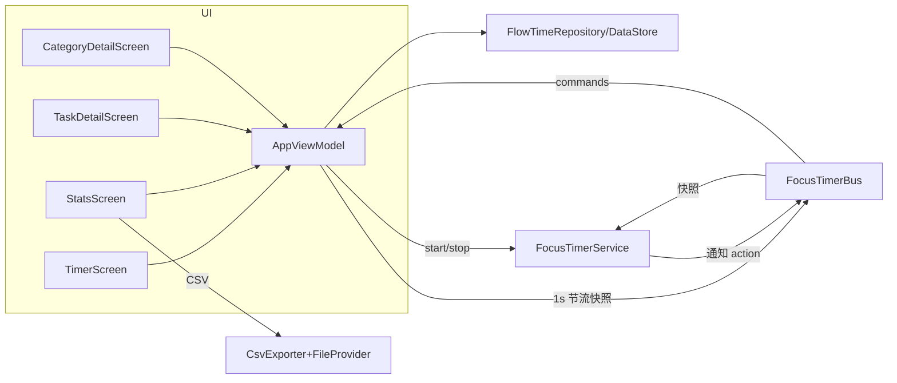

## 用户原始需求
本轮为「心流时间」App 的功能深化改造，用户一次性提出 15 项需求，核心围绕：任务与时长解耦、历史记录全量可翻页、任务大类体系、熄屏计时可靠性、数据可补录与可导出。

## 产品概述
在现有 Compose 版心流时间（计时/任务/统计/设置 4 Tab + 完成页）基础上，重构「任务-时长-记录」三者关系：任务只定义"做什么"（名称/图标/颜色/大类），时长在开始专注时选择；历史记录从"近 7 天"升级为"全部记录按周翻页"；新增任务大类（分类）体系承载分组统计；计时通过前台服务保证熄屏可靠；支持手动补录与 CSV 导出。

## 核心功能
- 新建任务轻量化：去掉时长设置，新增大类选择（可选已有大类或当场新建，大类自动配色）
- 首页重构：任务卡置顶；开始专注时选择时长（30/45/60/90/120/150 分钟 + 自定义，正计时模式无需时长）
- 任务详情：全部记录按周分页（每页 7 天柱状图 + 当周记录列表，左右滑动回到最早记录）+ 补录时间入口 + 所属大类入口
- 任务大类体系：大类含多个小任务；大类详情页展示各小任务时长分布（圆环图复用）、小任务列表、大类按周分页柱状图
- 统计页重构：近 7 天改为全部记录按周分页柱状图；移除每日目标卡；保留任务分布圆环图；底部 CSV 导出（按大类汇总 / 全部明细两种模式，系统分享）
- 任务清单双视图：列表视图 / 网格视图切换
- 计时体验：呼吸灯周期 2400ms 放慢至约 6000ms；正计时环改为 30 分钟转一圈；正计时超 12 小时自动结算兜底；时长显示统一 x h xx min；完成页移除「继续专注」按钮
- 熄屏计时：前台服务 + 常驻通知（显示剩余/已计时、暂停/停止操作），Android 13+ 请求通知权限
- 图标：保留 emoji 现状并抽象图标注册表，为用户后续提供 SVG/PNG 转 VectorDrawable 内置预留单点切换接口

## 澄清结论（用户已拍板）
按周分页；大类在新建任务对话框内选择/新建（轻量、自动配色、无独立管理页）；图标由用户后续提供素材内置；接受前台服务+常驻通知方案。


## 技术栈选择
全部沿用现有栈（已在项目内验证）：Kotlin + Jetpack Compose（BOM 2026.02.01）+ MVVM + Navigation Compose + DataStore Preferences（org.json 序列化）。新增能力均来自现有依赖，无需新增三方库：
- 翻页：androidx.compose.foundation.pager.HorizontalPager（foundation 已在 BOM 内，compose 1.4+ 稳定 API）
- 前台服务/通知：androidx.core（core-ktx 已依赖，含 NotificationCompat）
- CSV 文件分享：FileProvider（androidx.core 内置）

## 实现方案
### 总体策略
单次重构分四层推进：数据层先扩容（Category 实体 + categoryId 兼容），状态机再升级（周分页/大类聚合/补录/12h 兜底/CSV 构建），UI 按页重构（首页/任务/详情/统计/大类），最后接入前台服务并全量真机验证。所有 JSON 编解码沿用已验证的 optInt/optString 兼容模式，旧数据零迁移成本。

### 关键技术决策
1. **任务-时长解耦**：FocusTask.durationMinutes 字段保留（旧数据不动，默认 25 兜底），新建对话框移除时长项；AppViewModel 新增 selectedDurationMinutes（默认 30），startFocus 使用所选时长而非任务属性。选择结果不入库为任务属性。
2. **周分页数据模型**：新增 WeekPage(startDate, label, days: List<DayMinutes>, totalMinutes)；buildWeekPages(records, filter) 从本周向最早记录所在周生成页序列（index 0=本周，越大越早），供 HorizontalPager 使用；任务详情与统计页共用同一构建器（DRY）。页标签 "本周 / 09.22-09.28"。
3. **大类模型**：Category(id, name, colorIndex) 独立 JSON 键存储；FocusTask 加 categoryId（可空，空=未分类伪大类）；新建对话框内大类 chips + "＋新建"内联输入创建，颜色按 categories.size 自动取 DonutColors 循环。统计维度在 VM 派生：categoryTotals（大类聚合，圆环图）、categoryWeekPages（大类周分页）、任务按 categoryId 归组。
4. **熄屏计时（前台服务）**：计时状态机仍由 AppViewModel 唯一持有（避免双状态源），服务只负责保活与通知展示。新增轻量单例 FocusTimerBus（state: MutableStateFlow<通知所需快照>，commands: MutableSharedFlow<Pause/Resume/Stop>）：VM ticker 每秒节流推送快照到 Bus；FocusTimerService 观察 Bus 更新通知；通知 action 经 Bus 回传 VM 执行。startFocus/resume 时 startForegroundService，resetToIdle 时 stopService。
5. **CSV 导出**：CsvExporter 纯函数构建两种 CSV（明细：task_name,category,minutes,end_time；大类汇总：category,total_minutes,total_hours,session_count,task_count），写入 cacheDir/export 后经 FileProvider 以 ACTION_SEND (text/csv) 分享，避免存储权限。manifest 加 provider + res/xml/file_paths.xml。
6. **补录**：addManualRecord(taskName, minutes, dateMillis) 直接走现有 repo.addRecord，endEpochMillis 取所选日期当日 12:00（避免跨日时区边界问题）。
7. **图标接口**：抽象 TaskIcons 注册表对象（当前返回 emoji 列表），后续切换 VectorDrawable 图标集只改这一个文件。

### 性能与可靠性
- 周分页页数等于历史周数，pager 页面为惰性组合，柱状图每页 7 柱，复杂度 O(记录数) 一次性聚合，无 N+1
- HorizontalPager 用 key(weekStart) 保证状态稳定；页缓存默认即可，不预加载全部
- 通知更新 1s 节流，避免系统通知频率限制与电量损耗；服务 stopSelf 后通知同步移除
- CSV 构建为一次性字符串拼接，万级记录内无压力

### 架构设计


## 实现要点（执行纪律）
- 沿用 ProCard/Typography/主题色板/Entrance 入场等既有设计语言，不引入新视觉范式
- JSON 兼容写法参照既有 iconIndex 模式（optInt/optString 带默认值），旧任务 categoryId 缺省为 null 显示"未分类"
- TrendLineChart 在任务详情被柱状图替换后若无引用则删除，杜绝幽灵代码；成就徽章移除后残留的 combine 引用需复核
- 构建命令必须单独执行（cmd /c 内禁用 `;` 拼接）；真机截图走 screencap 到 /sdcard 再 pull
- AndroidManifest 需新增：POST_NOTIFICATIONS、FOREGROUND_SERVICE、FOREGROUND_SERVICE_SPECIAL_USE 权限，service 声明（foregroundServiceType="specialUse" + PROPERTY_SPECIAL_USE_FGS_SUBTYPE），FileProvider 声明；Android 13+ 首次开始专注时用 ActivityResultContracts.RequestPermission 请求通知权限
- 写后即记：完成后追加 .ai-memory 日志与 handoff

## 目录结构
```
app/src/main/java/com/example/flowtime/
├── data/
│   ├── Models.kt                    # [MODIFY] 新增 Category 实体；FocusTask 加 categoryId（可空）
│   └── FlowTimeRepository.kt        # [MODIFY] categories_json 键与编解码；tasks 解码兼容 categoryId；addCategory
├── ui/
│   ├── AppViewModel.kt              # [MODIFY] 周分页构建器/大类聚合 flows/补录/12h 兜底/时长选择/正计时 30min 环/consumeCompleted 精简
│   ├── FocusTimerBus.kt             # [NEW] 服务与 VM 间的状态/命令总线（StateFlow+SharedFlow 单例）
│   ├── timer/TimerScreen.kt         # [MODIFY] 任务卡置顶、时长选择 chips、正计时隐藏时长、布局重构
│   ├── tasks/TasksScreen.kt         # [MODIFY] 列表/网格双视图切换、新建对话框去时长+大类选择、卡片显示大类
│   ├── tasks/TaskDetailScreen.kt    # [MODIFY] 折线改柱状、HorizontalPager 周分页、补录对话框、大类入口
│   ├── stats/StatsScreen.kt         # [MODIFY] 周分页柱状图、移除每日目标卡与 goalFireworks、底部 CSV 导出入口与模式对话框
│   ├── category/CategoryDetailScreen.kt  # [NEW] 大类详情：小任务分布圆环图+小任务列表+大类周分页柱状图
│   ├── completion/CompletionScreen.kt    # [MODIFY] 移除「继续专注」按钮，仅保留信息卡与返回
│   ├── components/
│   │   ├── RingTimer.kt             # [MODIFY] RingGlow tween 2400→6000
│   │   ├── WeeklyBarsPager.kt       # [NEW] 按周分页柱状图组件（HorizontalPager + 页标签 + 当周合计，详情/统计/大类三处复用）
│   │   ├── TaskIcons.kt             # [NEW] 图标注册表（emoji 列表单点抽象，预留 VectorDrawable 切换）
│   │   └── MiniCharts.kt            # [MODIFY] TrendLineChart 若无引用则删除，保留 DonutChart
│   └── CsvExporter.kt               # [NEW] 两种模式 CSV 构建 + cacheDir 写文件 + FileProvider 分享 Intent
├── service/
│   └── FocusTimerService.kt         # [NEW] 前台服务：通知渠道、每秒更新通知、暂停/继续/停止 action
├── MainActivity.kt                  # [MODIFY] 大类详情路由、通知权限请求、服务启停对接
└── AndroidManifest.xml              # [MODIFY] 权限×3、service 声明（specialUse+property）、FileProvider
res/xml/file_paths.xml               # [NEW] FileProvider 路径配置（cache-path export）
```


## Agent Extensions
### Skill
- **dev-expert**
  - 用途：贯穿全程的工程纪律——写码前实码确认、规划门禁、构建验证硬闭环、写后即记与 handoff 交接
  - 预期结果：每个 Wave 有构建/真机证据，交付含验证证据与已知限制，记忆落盘可续作
- **ui-ux-pro-max**
  - 用途：周分页翻页交互、双视图切换、大类详情信息架构的 UX 准则核查（翻页方向语义、触控目标、空态文案、图表可读性）
  - 预期结果：新增交互符合移动端 UX 规范，柱状图/圆环图信息可读且配色对比达标
