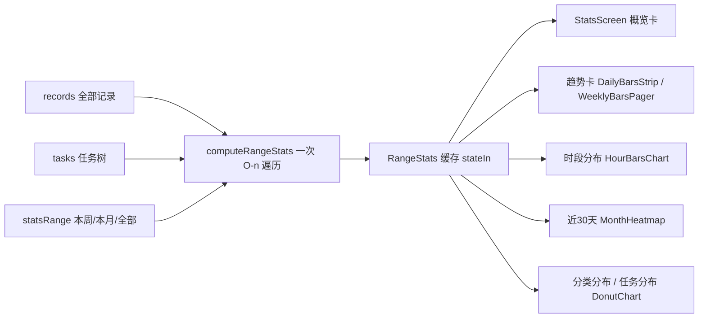

## 产品概述
统计页当前只有「三卡总览 + 专注趋势 + 任务分布 + 导出 CSV」四块，信息量偏少。本次在**不改变页面浏览方式（全部铺在一页、向下滚动）**的前提下，新增一个**统计范围切换（本周 / 本月 / 全部）**，并补充概览数值与三张图表，让用户能看到"我这周练了多少、什么时候最专注、能坚持多少天、时间花在哪类事上"。

## 核心功能
- **统计范围切换**：本周 / 本月 / 全部，切换后页面内相关卡片与图表的数据同步跟随（趋势、概览、时段分布、任务分布、分类分布）。三卡总览（总专注/今日/连续）与导出保持原有恒定语义。
- **概览卡（新增）**：标题随范围变化（本周概览 / 本月概览 / 全部概览），展示范围内「累计时长、日均、专注次数、单次最长」。
- **时段分布图（新增）**：按 24 小时聚合，找出最专注的时段并高亮（如"最专注 20:00-21:00 · 45 min"）。
- **近 30 天热力图（新增）**：7 列（周一至周日）× 5 行日历格子，颜色深浅代表当日专注时长，直观看出坚持情况（固定最近 30 天窗口）。
- **分类分布圆环（新增）**：按顶层任务（即"挂了小任务的任务/大类"）聚合的圆环 + 明细列表，与现有「任务分布」并列展示。
- 保持现有「专注趋势」「任务分布」「导出数据」功能与整页分段入场动画不变；全部新增区块沿用统一视觉风格。


## 技术栈
- 沿用现有栈，**不引入任何新依赖**：Kotlin + Jetpack Compose(Material3) + DataStore Preferences
- 图表全部用 Compose 原生绘制（`Canvas` / `Row+Box`），复用现有 `DonutChart`、`WeeklyBarRow` 的动画与配色模式
- 复用组件：`ProCard`(+`Modifier.softShadow()`)、`DonutChart`/`DonutSlice`、`WeeklyBarsPager`/`WeeklyBarRow`、`formatMinutesHm`、`CategoryBadge`、`pressScale`
- 主题 token：`ui/theme/Color.kt`（`WatercolorInk/Peach/Teal/Rose/Sand`、`PaperBase/PaperSoft/PaperElevated`、`Primary/PrimaryLight/AccentGreen/CardGreenLight/CardCream/SurfaceCard/BorderColor/TextPrimary/TextSecondary/TextPlaceholder`）、`ui/theme/Type.kt`（Serif + Light 标题）

## 实现方案

### 总策略
**一次聚合、一次缓存、UI 只订阅一个 flow**。范围切换是"同一份记录的不同切片"，因此把过滤 + 全部派生指标（概览、时段、热力图、任务/分类分布）合并到 ViewModel 的一次 O(n) 遍历里，用 `stateIn(Eagerly)` 缓存；Composable 内不再做重复过滤或分组（避免重组时重算）。

### 1. 数据层（AppViewModel + Models + Repository）
- 新增 `enum class StatsRange { WEEK, MONTH, ALL }`（本周/本月/全部）
- 新增范围状态：`private val _statsRange = MutableStateFlow(StatsRange.WEEK)`，初值从 `settings.statsRange` 读取；`fun updateStatsRange(range)` 同时写回设置
- 新增聚合结果与单次计算入口：
```kotlin
// 仅接口级示意
enum class StatsRange { WEEK, MONTH, ALL }

data class RangeStats(
    val range: StatsRange = StatsRange.WEEK,
    val records: List<FocusRecord> = emptyList(),   // 范围内记录
    val totalMinutes: Int = 0,                       // 范围内累计
    val dailyAverageMinutes: Int = 0,                // 范围内日均
    val sessionCount: Int = 0,                       // 范围内专注次数
    val longestSessionMinutes: Int = 0,              // 单次最长
    val activeDays: Int = 0,                         // 范围内有记录的天数
    val hourMinutes: List<Int> = List(24) { 0 },     // 24 小时分布
    val heatmap: List<HeatCell> = emptyList(),       // 近 30 天（固定窗口）
    val taskTotals: List<AppViewModel.TaskTotal> = emptyList(),      // 范围内
    val categoryTotals: List<AppViewModel.CategoryTotal> = emptyList(), // 范围内
)

data class HeatCell(val date: LocalDate, val minutes: Int, val inRange: Boolean)

val rangeStats: StateFlow<RangeStats> = combine(records, tasks, settings, _statsRange) { r, t, s, range ->
    computeRangeStats(r, t, range, s.statsRange)
}.stateIn(viewModelScope, SharingStarted.Eagerly, RangeStats())
```
- 范围口径（全部用 `ZoneId.systemDefault()` + `LocalDate` 比较，避免时区/跨月边界问题）：
  - `WEEK`：`today.with(DayOfWeek.MONDAY)` 起至今
  - `MONTH`：`today.withDayOfMonth(1)` 起至今
  - `ALL`：不过滤
- 派生指标口径：
  - 日均 = 范围内累计 ÷ **范围内已过天数**（本周=周一至今、本月=1 号至今、全部=首条记录日至今的自然天数），分母为 0 时返回 0（防除零）
  - 时段分布：`Instant.ofEpochMilli(endEpochMillis).atZone(zone).hour` 累加分钟
  - 单次最长：范围内 `maxOf { minutes }`，无记录为 0
  - 分类分布：沿用现有 `categoryTotals` 的「taskName → task.parentId → 顶层任务名」映射，但输入换成**范围内记录**（未分类归入「未分类」）
- 持久化（与已有 `task_list_view` 完全同一模式，保证退出应用后保持所选范围）：`AppSettings` 增加 `statsRange: String = "WEEK"`；Repository 增加 `stats_range` 键的读写
- **保留**现有 `stats`、`taskTotals`、`categoryTotals`（导出与任务详情仍用全量数据），不做破坏性改动

### 2. 新增图表组件（水彩风格，全部自适应宽度、自带入场动画与空态）
- **`HourBarsChart.kt`**：24 根柱（0-23 时），柱高按"该小时分钟数 / 最大值"归一化（最小分母取 30 分钟，避免小数据全平）；最高时段柱用 `Primary`，其余 `AccentGreen.copy(alpha = 0.55f)`；柱高 tween(520) + 逐根 delay 生长（与 `WeeklyBarRow` 一致）；x 轴仅标 0 / 6 / 12 / 18 / 23；组件只负责画图，卡片标题与"最专注"文案由 StatsScreen 传入。
- **`MonthHeatmap.kt`**：7 列（一~日）× 5 行网格（35 格），每格圆角 6dp 小方块，5 档**半透明叠色**（0 → `CardCream`；1-29 → `AccentGreen.copy(0.35f)`；30-59 → `AccentGreen.copy(0.55f)`；60-89 → `PrimaryLight.copy(0.6f)`；≥90 → `Primary.copy(0.75f)`）；范围外/未来天数留空（`Color.Transparent`）；不画数字，避免小格子不可读。
- **`WeeklyBarsPager.kt` [MODIFY] 内新增 `DailyBarsStrip`**：横向滚动按天柱状（本周 7 根、本月 28-31 根），直接复用 `WeeklyBarRow` 的单柱样式/动画；x 轴每 5 天标一次 `M/d`，今天用 `Primary` 高亮。与既有按周分页柱状图同属"柱状图家族"，放在同一文件保持内聚。

### 3. StatsScreen 页面结构（单页向下滚，沿用 `Entrance` 错峰入场，delay 依次 +80ms）
1. 标题「统计」+ 右侧**范围切换**（三枚 chip：本周 / 本月 / 全部；选中 = `CardGreenLight` 底 + `Primary` 字，与全站选中态一致）
2. 三卡总览（保持不变）：总专注 / 今日 / 连续 N 天
3. **概览卡（新）**：标题随范围（本周概览 / 本月概览 / 全部概览），内部四宫格 = 累计、日均、专注次数、单次最长（沿用现有 `DetailStat` 式三列布局的水彩卡片）
4. 「专注趋势」卡：范围 = 全部 → 保留 `WeeklyBarsPager`（按周分页左右滑看历史）；范围 = 本周/本月 → 改用 `DailyBarsStrip`（按天）
5. **「时段分布」卡（新）**：标题旁显示「最专注 20:00-21:00 · 45 min」，主体 `HourBarsChart`
6. **「近 30 天」卡（新）**：`MonthHeatmap`，下方文案「近 30 天 · X 天有记录 · 共 Y」
7. **「分类分布」卡（新）**：复用任务分布的"圆环 + 右侧明细列表"布局，数据 = 范围内 `categoryTotals`；当分类数 ≤ 1 时改为引导文案「在任务详情页给任务添加小任务，就会自动形成分类」
8. 「任务分布」卡：数据改为范围内 `taskTotals`
9. 「导出数据」卡与导出对话框：保持不变（仍导出全量）

### 系统架构（数据流）


### 执行注意
- **时区/边界**：统一本地时区，按 `LocalDate` 比较；"本周"从周一起算（与现有 `buildWeekPages` 一致）
- **性能**：所有分组/过滤只在 ViewModel 内做一次并缓存；卡片侧用 `remember(rangeStats)`，避免每次重组重算；记录量与 24/30 个桶都极小，整体 O(n)
- **空态与除零**：每张卡都有"暂无记录"占位（`TextPlaceholder` + 13sp）；日均分母为 0 返回 0；圆环总时长为 0 时不绘制
- **兼容性**：不删除任何现有卡片与导出功能；不动 `stats`/全量 `taskTotals`/`categoryTotals` 的既有签名，避免影响任务详情与 CSV 导出
- **水彩风格自检**：只用主题 token 与半透明叠色，禁止纯黑背景、高饱和色、直角、粗字重（字重上限 `Medium`）；新卡片统一 `ProCard`（24dp 圆角 + 20% 蓝灰描边 + `softShadow`）；卡片内边距 20dp、卡片间距 16dp，与现有一致
- **不新增第三方依赖**；`app/build.gradle.kts` 与 `libs.versions.toml` 无需改动

## 目录结构
```
app/src/main/java/com/example/flowtime/
├── ui/
│   ├── AppViewModel.kt                    # [MODIFY] 新增 StatsRange 枚举、_statsRange 状态、RangeStats 与 computeRangeStats（范围内概览/时段/热力图/任务与分类分布），updateStatsRange 写回设置；保留原有 stats/taskTotals/categoryTotals
│   ├── stats/
│   │   └── StatsScreen.kt                 # [MODIFY] 顶部范围切换 chip；新增概览卡、时段分布卡、近30天热力图卡、分类分布卡；趋势卡按范围在 WeeklyBarsPager 与 DailyBarsStrip 间切换；任务分布改用范围内数据；三卡总览与导出保持不变；延续 Entrance 错峰入场与既有卡片样式
│   └── components/
│       ├── WeeklyBarsPager.kt             # [MODIFY] 新增 DailyBarsStrip（按天柱状、横向滚动、每5天标日期、今天高亮），复用 WeeklyBarRow 的柱子样式与生长动画
│       ├── HourBarsChart.kt               # [NEW] 24 小时柱状图：归一化柱高、最高时段用 Primary 高亮、其余半透明青绿、x 轴标 0/6/12/18/23、逐根生长动画、空态占位
│       └── MonthHeatmap.kt                # [NEW] 近 30 天热力图：7列×5行圆角格子、5 档半透明水彩色阶、范围外留空、无数字标注（保证小格子可读）
└── data/
    ├── Models.kt                          # [MODIFY] AppSettings 增加 statsRange: String = "WEEK"（统计范围持久化）
    └── FlowTimeRepository.kt              # [MODIFY] 读写新增偏好键 stats_range（与已有 task_list_view 同一模式）
```

## 关键代码结构
```kotlin
// AppViewModel：范围统计的单一入口（供 StatsScreen 订阅）
enum class StatsRange { WEEK, MONTH, ALL }

data class HeatCell(val date: java.time.LocalDate, val minutes: Int, val inRange: Boolean)

data class RangeStats(
    val range: StatsRange = StatsRange.WEEK,
    val totalMinutes: Int = 0,
    val dailyAverageMinutes: Int = 0,
    val sessionCount: Int = 0,
    val longestSessionMinutes: Int = 0,
    val activeDays: Int = 0,
    val hourMinutes: List<Int> = List(24) { 0 },
    val heatmap: List<HeatCell> = emptyList(),
    val taskTotals: List<TaskTotal> = emptyList(),
    val categoryTotals: List<CategoryTotal> = emptyList(),
)

// 组件签名（新图表，全部自带空态与入场动画）
@Composable fun HourBarsChart(hourMinutes: List<Int>, modifier: Modifier = Modifier)
@Composable fun MonthHeatmap(cells: List<HeatCell>, modifier: Modifier = Modifier)
@Composable fun DailyBarsStrip(days: List<AppViewModel.DayMinutes>, modifier: Modifier = Modifier)
```


## Agent Extensions
### Skill
- **dev-expert**
  - Purpose: 实现并复核数据层聚合逻辑（`computeRangeStats` 的一次遍历、范围口径与除零/空态保护、`stateIn` 缓存策略），并检查是否引入性能或兼容性回归
  - Expected outcome: 聚合函数为纯函数、单次 O(n)、范围口径明确；构建与 lint 通过；不破坏既有 `stats`/`categoryTotals`/导出
- **ui-ux-pro-max**
  - Purpose: 为三张新图表确定可读性规格（24 小时柱状图的轴标注与柱宽、热力图 5 档色阶与格子尺寸、圆环占比的最低可读阈值），确保与"水彩画风"约束一致（半透明叠色、大圆角、低饱和）
  - Expected outcome: 给出各图表的色阶档位/标注规则/最小尺寸结论，并落到组件实现中；无纯黑、无高饱和、无直角、无粗字重
